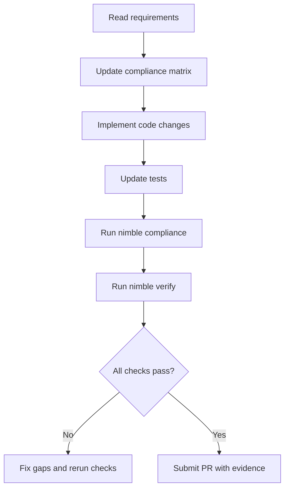
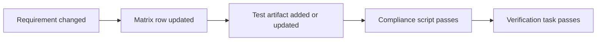

# Wilder Cosmos Runtime - Development Guidelines

## ND Terminology (Canonical Definition)

**ND means Neurodivergent (ND) throughout all Wilder Cosmos documentation and code.**

*ND must always be expanded as "Neurodivergent (ND)" on first use in every file, including source, documentation, comments, help text, templates, tests, plans, and walkthroughs. Do not use ND to mean Non-Determinist or Non-Deterministic. If you need to refer to determinism, always write out "deterministic" or "non-deterministic" in full.*

This guide provides practical, repeatable steps for implementing requirements with clear evidence.

## Scope

Use this guide when:
- adding or changing requirements,
- implementing runtime behavior,
- preparing pull requests,
- reviewing compliance readiness.

## Standard Development Loop

1. Read the affected requirement in docs/implementation/MVP-REQUIREMENTS.md.
2. Check its row in docs/implementation/MVP-COMPLIANCE-MATRIX.md.
3. Implement code changes.
4. Add or update tests.
5. Update the matrix row and, if needed, tests/KNOWN_FAILURES.txt.
6. Run compliance and verification tasks, and record the evidence in the commit or
   pull request.

Example commands:

```powershell
nimble compliance
nimble test
nimble verify
```

Expected outcome:
- compliance script reports pass, including one matrix row per MVP requirement,
- every test passes or is a listed known failure, and the gate ends with
  `Gate passed.`

## Input Validation Practices

When implementing any public procedure:
1. **Validate at the boundary:** all public procs must validate inputs immediately.
2. **Use fail-fast validation:** reject invalid inputs without downstream processing.
3. **Centralize validation logic:** use helper procedures from `runtime/validation.nim`
   or create reusable helpers in your module.
4. **Document validation rules:** in the proc docstring, list all validation checks
   and expected errors.
5. **Sanitize error messages:** never expose sensitive data (credentials, keys,
   personal info) in error messages or logs.
6. **Log failures with context:** include invalid input (or hash), rule violated,
   and operation context.

Example proc with validation:

```nim
proc user__setAge(age: int): bool =
  ## Set user age. Validates age is in range [0, 150].
  ##
  ## Raises: ValueError if age is invalid.
  if age < 0 or age > 150:
    raise newException(ValueError,
      "Age must be in range [0, 150], got: " & $age)
  # ... proceed with mutation
  return true
```

## Requirement Change Checklist

When editing requirements:
- add or update terms if new terminology appears,
- add at least one concrete command or behavioral example,
- add or update one diagram for complex flow changes,
- give a new requirement an `MVP-…` ID and a row in
  docs/implementation/MVP-COMPLIANCE-MATRIX.md in the same change set,
- say how it's met in docs/implementation/MVP-SPECIFICATION.md, and mark any change
  to the long-term REQUIREMENTS.md or SPECIFICATION.md as **Departs**,
- confirm scripts/verify/check_requirements.ps1 still passes.

## Code Comment Contract

For each `.nim` file:
- include identity header lines: `# Wilder Cosmos <version>`,
  `# Module name: <module name>`, and
  `# Module Path: <workspace-relative path>`,
- include `Summary`, `Simile`, `Memory note`, and module-level `Flow` in the header block,
- place a `Flow` comment directly above every `proc` declaration,
- use professional, plain language with direct verbs,
- avoid emotional or figurative wording in procedural comments,
- generate new module headers from templates in `templates/headers/` using
  `scripts/dev/new_nim_module.ps1`.

## Naming Conventions

- **Format:** `typeObject__verb()` (double underscore between type and verb). Use lowercase and underscore separators for readability.
- **TypeObject:** a singular noun identifying the subject, module, or primary type the function acts on.
- **Verb:** an imperative present-tense action describing what the proc does (e.g., `run`, `dispatch`, `create`, `commit`).
- **Examples:** `playground__run()`, `thing__create()`, `ledger__commit()`.
- **Avoid** generic verbs like `handle` for exports; prefer concrete verbs that convey intent. If an API requires a parameter named `handle` (for example `registerModule(..., handle: proc ...)`), name your exported proc using the `typeObject__verb()` style and pass it as the `handle` argument.
- **When to use manager/controller:** reserve `*_manager` or `*_controller` for objects that encapsulate state and multiple coordinated operations.

## Entry Point Module Naming

- **Standard:** Append `_main` to any entry point module.
- **Purpose:** This ensures clarity and consistency in identifying entry points.
- **Example:** `cosmos_main.nim` for the `cosmos` command.
- **Scope:** Applies to all new and existing entry point modules.
- **Rationale:** This convention avoids ambiguity and aligns with the project's structured naming approach.

## Line Wrapping

- **Wrap width:** All source code lines and code examples must be wrapped at 80 characters.
- **Scope:** Applies to `.nim` source, code blocks in documentation, and inline examples in docs.
- **Tooling:** Prefer automated wrapping (formatters or editor settings). For signatures, break after logical separators and keep continuations indented.

## PR Evidence Checklist

For each requirement area touched in a PR:
- Requirement reference: `MVP-…` ID in docs/implementation/MVP-REQUIREMENTS.md
- Implementation reference: file path and proc/type name
- Verification reference: test file or validation script
- Outcome: pass/fail with short evidence note

Example evidence row:

| Requirement | Implementation | Verification | Outcome |
| --- | --- | --- | --- |
| MVP-CON-1 | src/runtime/console.nim renderAll | tests/unit/console_status_test.nim | Pass (gate) |

## Development Flow Diagram



## CI Workflow Behavior

Continuous integration (CI) and release workflows are deferred while the MVP targets
one machine (MVP-SPECIFICATION §8). The gate is run locally with `nimble verify`,
and a change counts only once it passes there. The Codeberg `.woodpecker.yml`
predates the MVP and isn't part of the gate.

## Requirement-to-Test Update Diagram



## ND-Friendly Writing Rules

Use these rules in comments, docs, help text, templates, and tests:
- use short sentences and direct verbs,
- define new terms before using them repeatedly,
- **expand every acronym or initialialism on its first use in every file.**
  Write the full term, then the short form in parentheses:
  `Full Name (ABBR)`. Subsequent uses may use the short form alone.
  This applies without exception to source files, docs, comments,
  help text, templates, tests, plans, and walkthroughs,
- avoid figurative or emotional language in procedural instructions,
- keep examples executable and complete,
- prefer one concept per paragraph or bullet.

---
*&copy; 2026 Wilder. All rights reserved.*\
*Contact: teamwilder@wildercode.org*\
*Licensed under the Wilder Foundation License 1.0.*\
*See LICENSE for details.*